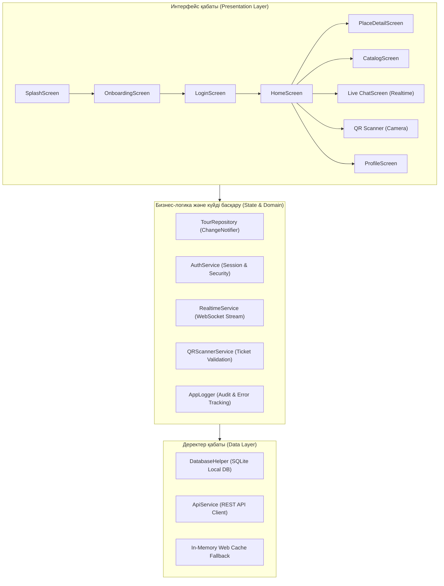

# 🦅 SteppeTrip — Мобильді туристік қосымшасы

> **SteppeTrip** — Қазақстанның экологиялық, тарихи және табиғи көрікті орындарына (Көлсай, Шарын, Бурабай, Қатонқарағай және т.б.) арналған көпплатформалы Flutter мобильді қосымшасы. Жоба заманауи Offline-First архитектурасына, SQLite деректер қорына, REST API синхрондауына, QR-код сканеріне және нақты уақыттағы WebSocket Live-чатына негізделген.

---

## 📱 Жобаның негізгі мүмкіндіктері

1. **Заманауи пайдаланушы интерфейсі (UI/UX):**
   - Қазақстанның ұлттық нақышына сай бейімделген изумруд-жасыл және алтын түсті дизайн жүйесі (`AppTheme`).
   - Onboarding экраны, Категориялар, Таңдаулылар (Favorites), Іздеу (Search) және Түсініктемелер (Reviews).
2. **Авторизация және қауіпсіздік (Auth & Session):**
   - Тіркелу (Register), Жүйеге кіру (Login), Құпия сөзді қалпына келтіру (Forgot Password).
   - Формалар валидациясы (Email, телефон, құпия сөз күрделілігі).
   - Токенге негізделген сессияны сақтау (`Remember me`) және қауіпсіз жүйеден шығу (`Logout`).
3. **Локалды деректер қоры (SQLite CRUD):**
   - Толыққанды `sqflite` кестелері: `tours`, `bookings`, `reviews`, `users`.
   - Барлық CRUD операциялары (Create, Read, Update, Delete) жергілікті деңгейде лезде орындалады.
4. **REST API және Офлайн-синхрондау (Offline-First):**
   - Серверлік деректермен синхрондау (`GET /tours`, `POST /bookings`, `PUT /tours/:id`, `DELETE /tours/:id`).
   - Желі үзілгенде қосымша авто-түрде локалды SQLite кэшіне өтеді және желі пайда болғанда фондық синхрондау жасайды.
5. **Құрылғының күрделі функциясы (Hardware Integration):**
   - **QR-код билет сканері:** Саяхатшылардың электронды билеттерін тексеру.
   - Камера рұқсатын сұрау (`Camera Permission Handler`) және валидация.
6. **Нақты уақыттағы байланыс (Realtime & WebSocket):**
   - Тур гидімен және қолдау қызметімен онлайн екіжақты чат (`Live Chat`).
   - Брондау және сапар күйлерін нақты уақытта тарату (`LiveTourUpdate`).
   - Байланыс үзілгенде автоматты түрде қайта қосылу (`Auto-reconnect with backoff`).
7. **Құрылымдалған лог жүйесі (AppLogger):**
   - `DEBUG`, `INFO`, `WARNING`, `ERROR`, `REALTIME` деңгейлеріндегі аудит.

---

## 🏗️ Қосымшаның архитектурасы



---

## 🚀 Орнату және іске қосу нұсқаулығы

### Қажетті құралдар:
- Flutter SDK (3.x немесе одан жоғары)
- Dart SDK (3.x)
- Google Chrome (немесе Android Studio / VS Code)

### Қадамдар:

1. **Репозиторийді ашу:**
   ```bash
   cd steppetrip
   ```

2. **Тәуелділіктерді жүктеу:**
   ```bash
   flutter pub get
   ```

3. **Қосымшаны Chrome браузерінде іске қосу:**
   ```bash
   flutter run -d chrome
   ```

4. **Android құрылғысында немесе эмуляторында іске қосу:**
   ```bash
   flutter run
   ```

5. **Мобильді APK жинақтау (Build APK):**
   ```bash
   flutter build apk --release
   ```
   *Дайын файл жолы:* `build/app/outputs/flutter-apk/app-release.apk`

6. **Барлық 15 Test Case тестін орындау:**
   ```bash
   dart run test/run_practice8_tests.dart
   ```

---

## 🧪 Тестілеу және Сапа бақылау (Quality Assurance)
Жобада барлығы **15 автоматтандырылған Test Case** енгізілген:
- **Авторизация және сессия:** Тіркелу, кіру, сессияны қалпына келтіру, шығу (TC-01..TC-05).
- **SQLite деректер қоры:** Тур қосу, оқу, өзгерту, жою (TC-06..TC-09).
- **REST API:** Синхрондау және брондау жіберу (TC-10, TC-11).
- **QR Сканер & Камера:** Билетті тексеру және камера интеграциясы (TC-12).
- **Realtime WebSocket & Chat:** Қосылу, хабарламалар алмасу (TC-13, TC-14).
- **Логтау жүйесі:** Оқиғалар мен қателердің дұрыс тіркелуі (TC-15).

---

## 👨‍💻 Әзірлеушілер тобы
- **Жоба:** SteppeTrip Mobile Application
- **Платформа:** Flutter & Dart
- **Жылы:** 2026
